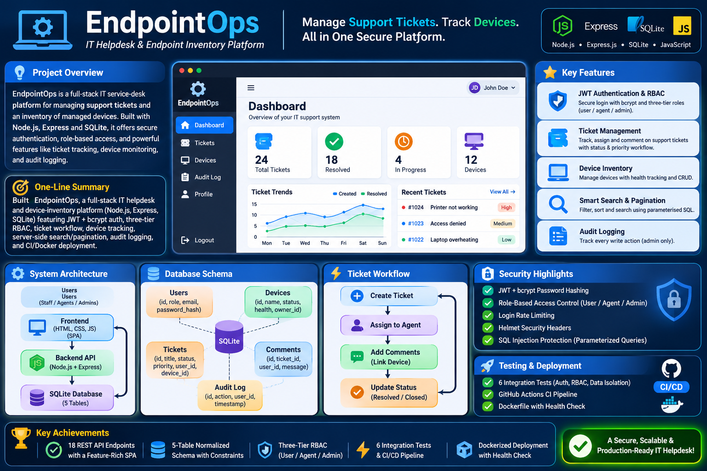

# EndpointOps: IT Helpdesk & Endpoint Inventory Platform

A full-stack web app for managing IT support tickets and an inventory of managed devices (laptops, servers),
modelled on the workflows of IT service-desk and endpoint-management products.

<div align="center">
  
</div>

## Features
- **Auth:** registration and login, bcrypt-hashed passwords, JWT (8h expiry), login rate limiting
- **RBAC:** three roles (user, agent, admin) enforced server-side on every route
- **Tickets:** CRUD, priority/status workflow, assignment, comments, link to a device
- **Devices:** inventory CRUD with health status (healthy / needs attention / offline)
- **Search & filter:** full-text search, status/priority filters, sorting, pagination (server-side)
- **Dashboard:** aggregate stats via SQL GROUP BY
- **Audit log:** every write action recorded; admin-only viewer
- **Security:** parameterised SQL (no injection), Helmet headers, input validation, output escaping (XSS), ownership isolation
- **Quality:** 6 integration tests (auth, RBAC, isolation, search, injection attempt, CRUD), GitHub Actions CI, Docker

## Tech stack
Node.js 22, Express, SQLite (better-sqlite3), JWT, bcryptjs, Helmet, vanilla JS SPA, Docker, GitHub Actions

## Run
```bash
npm install
npm start            # http://localhost:3000
npm test
docker build -t endpointops . && docker run -p 3000:3000 -v eo-data:/data -e JWT_SECRET=change-me endpointops
```
Demo logins: `admin@endpointops.dev / Admin@123`, `agent@endpointops.dev / Agent@123`
(set `JWT_SECRET` in production; the seeded passwords are for demo only).

## API overview
| Method | Route | Access |
|---|---|---|
| POST | /api/auth/register, /api/auth/login | public |
| GET | /api/auth/me | any user |
| GET/POST | /api/tickets (q, status, priority, sort, order, page, limit) | any user (own tickets only for role=user) |
| GET/PATCH | /api/tickets/:id | owner or staff (status/assignee: staff only) |
| POST | /api/tickets/:id/comments | owner or staff |
| DELETE | /api/tickets/:id | admin |
| GET/POST/PUT | /api/devices | agent, admin |
| DELETE | /api/devices/:id | admin |
| GET/PATCH | /api/users, /api/users/:id/role | agent+ / admin |
| GET | /api/stats | any user (scoped) |
| GET | /api/audit | admin |

## Resume bullets (edit to match what you actually did)
- Built **EndpointOps**, a full-stack IT helpdesk and device-inventory platform (Node.js, Express, SQLite, JavaScript) with a REST API of 20+ endpoints and a responsive SPA frontend.
- Implemented **JWT authentication with bcrypt** password hashing and **role-based access control** (user/agent/admin) enforced on every endpoint, plus login rate limiting and Helmet security headers.
- Designed a normalised relational schema (users, devices, tickets, comments, audit log) with foreign keys, CHECK constraints and indexes; implemented **server-side search, filtering, sorting and pagination** using parameterised SQL.
- Wrote **integration tests** covering auth, RBAC, data isolation and SQL-injection attempts; set up **GitHub Actions CI** and a **Dockerfile** with health check for containerised deployment.

## Ideas to extend (great interview talking points)
React or Angular frontend, PostgreSQL, refresh tokens, WebSocket live updates, an agent script that reports device health to the API, SLA timers, OpenAPI docs.
